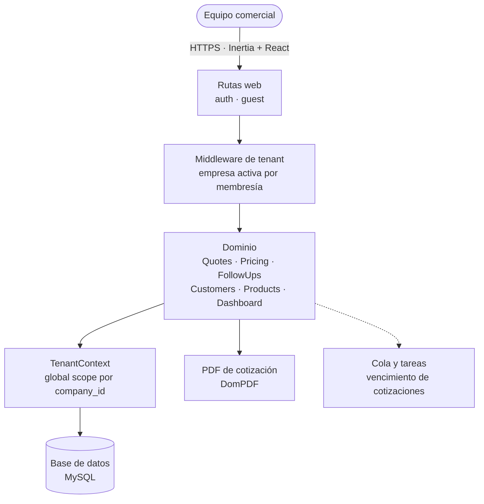
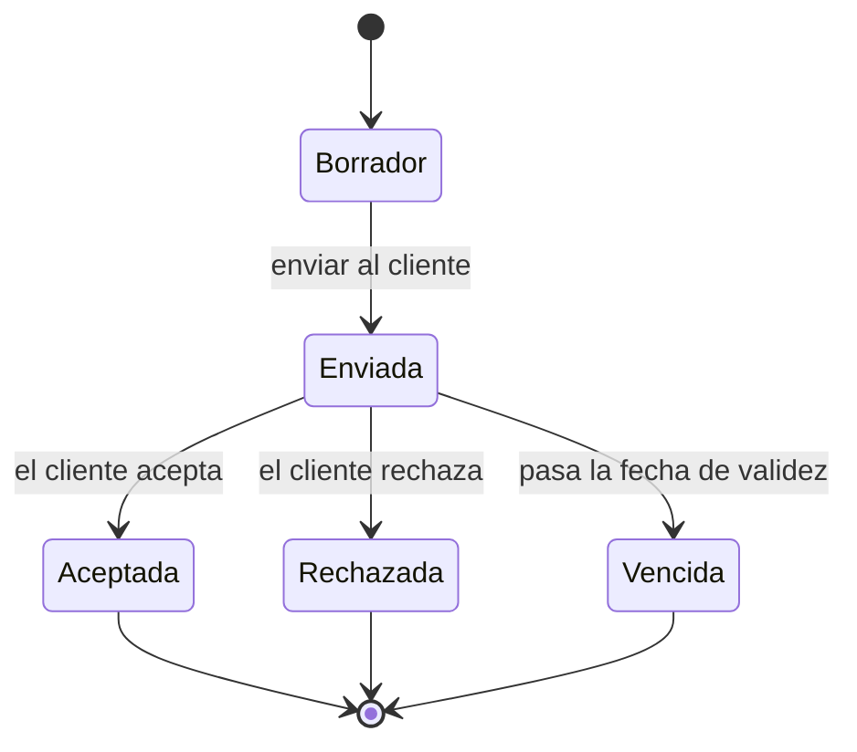
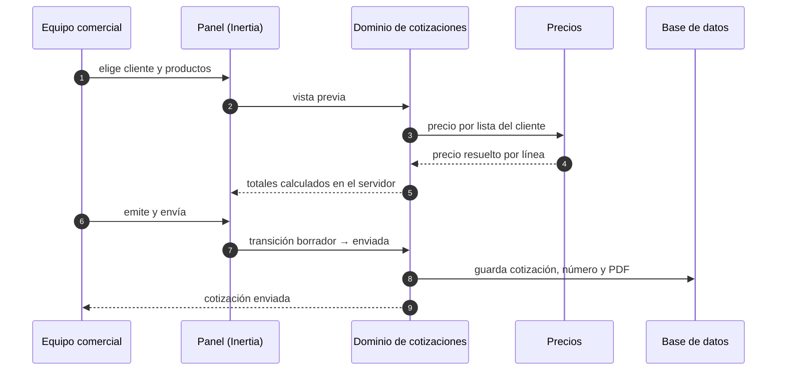
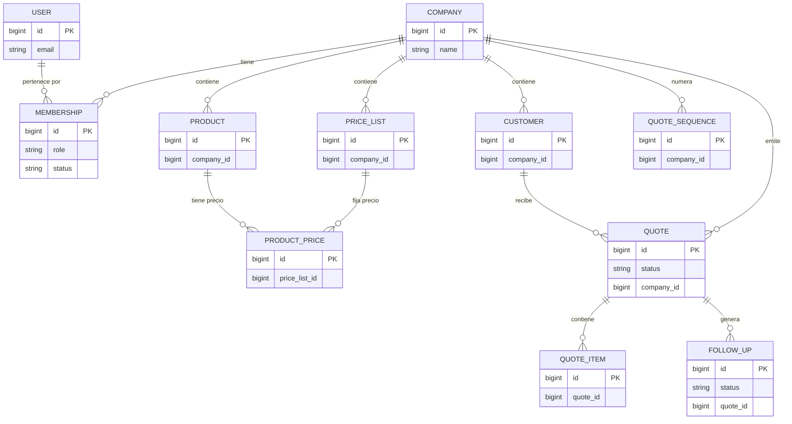

<div align="center">

<br/>

**Sistema operativo de cotizaciones para distribuidores y empresas B2B: clientes, productos, precios, PDF y seguimiento en un solo flujo.**


<br/>


</div>


##  Contenido

- [El problema](#-el-problema)
- [La solución](#-la-solución)
- [Funcionalidades](#-funcionalidades)
- [Arquitectura](#-arquitectura)
- [Flujos de trabajo](#-flujos-de-trabajo)
- [Modelo de datos](#-modelo-de-datos)
- [Criterios y decisiones](#-criterios-y-decisiones)
- [Stack](#-stack)
- [Estructura del repo](#-estructura-del-repo)
- [Puesta en marcha](#-puesta-en-marcha)
- [Pruebas y calidad](#-pruebas-y-calidad)
- [Documentación](#-documentación)
- [Despliegue](#-despliegue)
- [Estado y pendientes](#-estado-y-pendientes)
- [Licencia y autoría](#-licencia-y-autoría)


##  El problema

En un equipo comercial B2B, una cotización sigue un recorrido que se rompe fácil: el cliente consulta, alguien busca el producto y su precio, se arma un PDF o una planilla, se envía, y después nadie vuelve a llamar. Las cotizaciones enviadas que no reciben respuesta son ventas que se pierden sin que nadie lo note. La documentación de producto apunta a ese punto como el problema visible.

##  La solución

CotizaFlow mantiene en un solo lugar los clientes, los productos, las listas de precios, las cotizaciones con su PDF y los seguimientos pendientes, con un dashboard que prioriza qué llamar hoy.

| Actor | Qué hace |
|---|---|
| **Equipo comercial** | Crea cotizaciones con precios de la lista del cliente, envía el PDF, registra la respuesta y agenda seguimientos. |
| **Administración de la empresa** | Gestiona productos, listas de precios, clientes y usuarios de su empresa. |

Cada empresa es un tenant aislado: un usuario nunca ve datos de otra empresa, aunque tenga cuenta en varias.


##  Funcionalidades

<details open>
<summary><b>Cotizaciones</b></summary>

- Borrador con búsqueda de cliente y de producto, precio resuelto desde la lista del cliente y totales calculados en el servidor.
- Vista previa antes de emitir y PDF de la cotización.
- Estados: **borrador, enviada, aceptada, rechazada y vencida**. Una cotización vencida se marca automáticamente.

</details>

<details open>
<summary><b>Seguimiento y dashboard</b></summary>

- Seguimientos asociados a cada cotización, con estados **pendiente, completado y cancelado**.
- Lista de seguimientos pendientes y dashboard comercial con acciones concretas.

</details>

<details open>
<summary><b>Catálogo y precios</b></summary>

- Clientes y productos con estado de activación; unidades de producto.
- Listas de precios con productos y precio por lista, y resolución de precio por cliente.

</details>

<details>
<summary><b>Empresas y acceso</b></summary>

- Login, selección de empresa activa y membresías con rol y estado por empresa.
- Transferencia de titularidad de una empresa con autorización explícita.

</details>


##  Arquitectura

<p align="center">
  
</p>

Monolito modular Laravel con Inertia para el frontend en React. El dominio se organiza por contexto en `app/Domain/` (Clientes, Productos, Precios, Cotizaciones, Seguimientos, Dashboard, Dinero y Tenancy). Un `TenantContext` fija la empresa activa y un global scope la aplica a las consultas.



El `company_id` que llega desde el cliente es un dato no confiable. La única ruta autorizada para cambiar de empresa es `ActivateCompanyForUser`, que verifica la membresía del usuario autenticado (ver [`docs/architecture/TENANCY.md`](docs/architecture/TENANCY.md)).


##  Flujos de trabajo

### Ciclo de una cotización

Las transiciones se validan en `TransitionQuoteStatus`; una cotización aceptada o rechazada ya no vuelve al borrador.



### Emisión de una cotización




##  Modelo de datos



Toda entidad comercial lleva `company_id` de forma explícita. Los importes se guardan como decimales y se calculan con aritmética decimal (ver ADR 0002).


##  Criterios y decisiones

| Decisión | Por qué |
|---|---|
| **Company como único tenant** | Es el límite de aislamiento. Una sucursal sería una subdivisión dentro de la empresa, nunca un tenant. |
| **`User` global y `Membership` por empresa** | La misma persona puede trabajar en varias empresas con un rol distinto en cada una. El rol nunca vive en `User`. |
| **Empresa activa solo por membresía** | Un `company_id` del cliente no se confía; se valida contra la membresía del usuario autenticado. Ver ADR 0001. |
| **Dinero con aritmética decimal** | Los totales no dependen de floats. Ver ADR 0002. |
| **Precios resueltos en el servidor** | El precio sale de la lista del cliente y del producto, no de lo que manda el formulario. |
| **Reglas de negocio en el dominio** | Transiciones de estado, numeración y cálculo viven en `app/Domain/`, no en los controladores. |
| **Inertia con React** | Una sola aplicación desplegable con interacción en el panel, sin API separada para cada pantalla. |


##  Stack

Versiones tomadas de `composer.json` y `package.json`.

| Capa | Tecnología | Versión |
|---|---|---|
| Backend | PHP · Laravel | `^8.4` · `^13.17` |
| Puente SPA | Inertia Laravel · Inertia React | `^3.3` · `^3.7.0` |
| Frontend | React · TypeScript | `^19.2.8` · `^7.0.2` |
| Build y estilos | Vite · Tailwind CSS | `^8.0.0` · `^4.0.0` |
| PDF y dinero | Laravel Dompdf · brick/math | `^3.1` · `^0.18` |
| Datos | MySQL (`DB_CONNECTION=mysql` en `.env.example`) | — |
| Pruebas | Pest · Vitest · Playwright | — · `^5.0.0` · `^1.63.0` |
| Calidad | oxlint · Prettier | `^1.82.0` · `^3.9.6` |


##  Estructura del repo

```text
app/
├── Domain/                 Customers · Products · Pricing · Quotes · FollowUps · Dashboard · Money · Tenancy
├── Http/Controllers/       controladores delgados
├── Http/Middleware/        tenant y acceso
└── Models/                 Company · Membership · Customer · Product · PriceList · Quote · FollowUp…
database/migrations/        empresas, membresías, clientes, productos, listas de precios, cotizaciones, seguimientos
resources/js/              frontend React + Inertia
routes/web.php              rutas de login, empresas, catálogo, cotizaciones y seguimientos
tests/                      Feature · Unit · Browser (Playwright) · Fixtures
docs/                       producto, arquitectura, ADR, diagramas, workflows, comercial
```


##  Puesta en marcha

Requisitos: PHP 8.4 o superior, Composer, Node.js y MySQL.

```bash
composer install
npm install
cp .env.example .env
php artisan key:generate
php artisan migrate
npm run dev
```

- Las variables de base de datos y de correo se configuran en `.env` (no versionado).
- Los comandos de la aplicación están en `composer.json` y `package.json`.


##  Pruebas y calidad

```bash
npm run typecheck     # tsc --noEmit
npm run lint          # oxlint con reglas de React y accesibilidad
npm run test          # vitest run
npm run build         # vite build
php artisan test      # Pest
npx playwright test   # pruebas E2E en tests/Browser
```

- Hay pruebas Feature, Unit y de navegador (clientes, productos y precios, cotizaciones, seguimientos y dashboard).
- **No se ejecutaron para este README**; el número de pruebas no se documenta aquí.


##  Documentación

| Documento | Qué encuentras |
|---|---|
| [`docs/README.md`](docs/README.md) | Índice de toda la documentación |
| [`docs/product/`](docs/product/) | Visión, ICP y roadmap |
| [`docs/architecture/`](docs/architecture/) | Visión general, multi-tenancy, motor de precios, IA y seguridad |
| [`docs/adr/`](docs/adr/) | Decisiones de arquitectura (ADR 0001 y 0002) |
| [`docs/diagrams/`](docs/diagrams/) | Diagramas verificables con Archify |
| [`docs/workflows/`](docs/workflows/) | Desarrollo de features, revisión de código y checklist de release |
| [`docs/commercial/`](docs/commercial/) | Activos para los primeros clientes fundadores |


##  Despliegue

No documentado en el repositorio. No se encontraron Dockerfile, Compose ni workflows de CI en la raíz.


##  Estado y pendientes

- Último commit: **04-10-2026** (`70d2d7a`, «fix: load vite react refresh preamble»), precedido por documentación de la validación con clientes fundadores.
- Fase: **validación comercial** con clientes fundadores; la documentación de producto la describe como fase de validación, no de operación en producción.
- Pendientes documentados: ver [`docs/product/ROADMAP.md`](docs/product/ROADMAP.md) y [`docs/commercial/VALIDATION_BACKLOG.md`](docs/commercial/VALIDATION_BACKLOG.md).


##  Licencia y autoría

Desarrollado por el **Ing. Santiago Abasto**.


El repositorio no incluye archivo de licencia. Código propietario; no se distribuye sin autorización.
